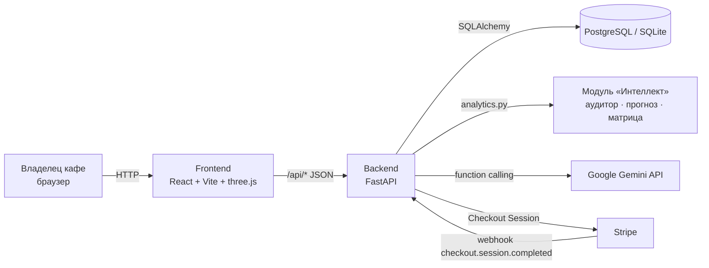
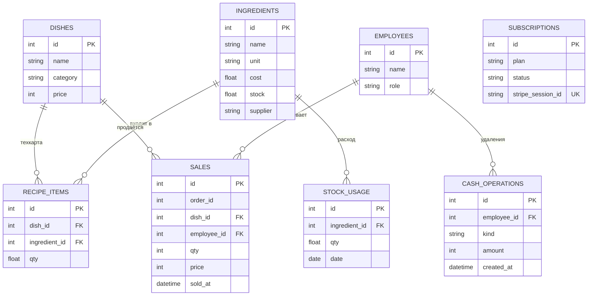
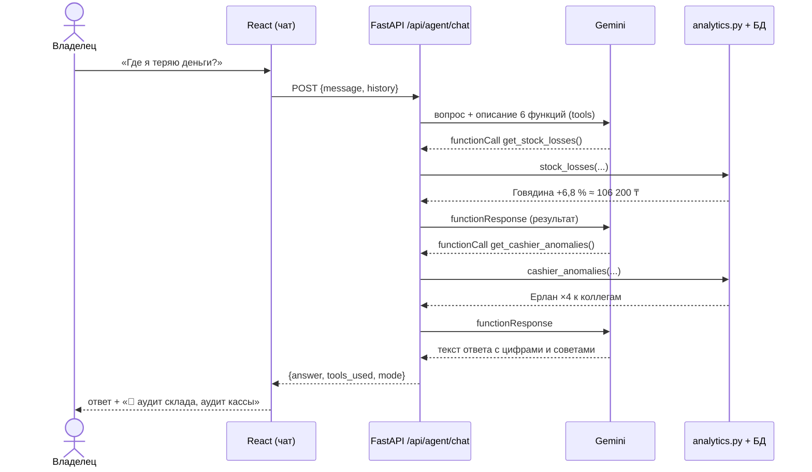
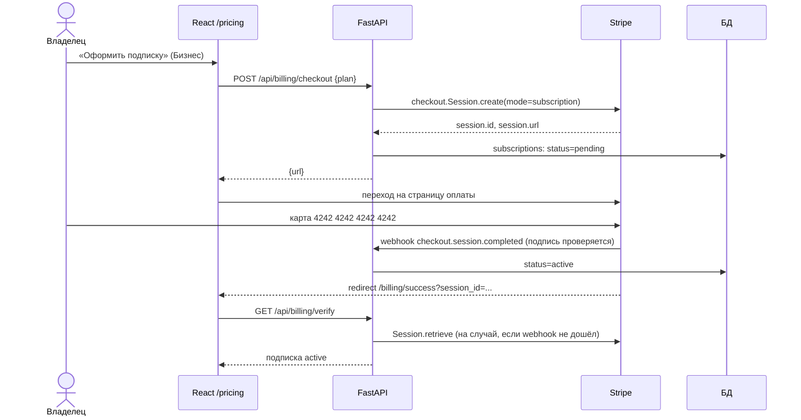
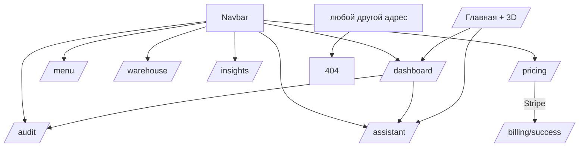

# Архитектура Tabys

Диаграммы написаны на Mermaid — GitHub рисует их прямо на этой странице.

## 1. Компоненты системы

## 2. База данных (ER-диаграмма)

## 3. Как работает AI-агент (sequence)

## 4. Как работает оплата (sequence)

## 5. Навигация по сайту

## 6. Дизайн

Figma: https://www.figma.com/design/WveOJjh2JQ1AHckUkBgZOz — страница «Дизайн-система» (цвета-переменные, 9 стилей текста, компоненты Button, Chip, Badge, StatCard, FeatureCard, IncidentCard, NavBar, Footer), «Desktop 1440» (8 экранов), «Mobile 390» (3 экрана).
